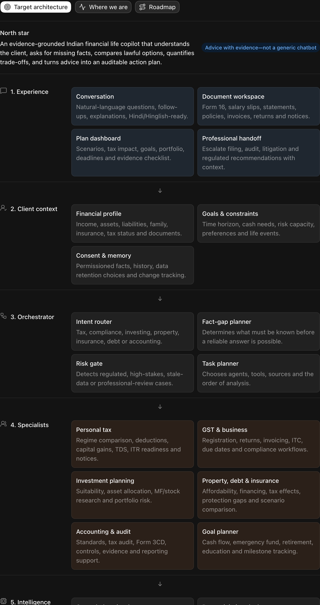
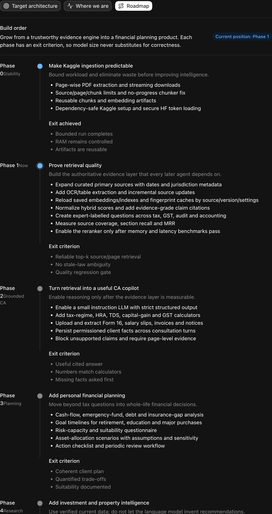
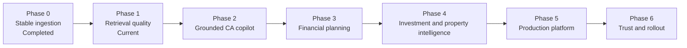

# Finance CA Assistant: Architecture and Roadmap

> Living document. Update this file whenever a capability is implemented,
> removed, validated, or moved between roadmap phases.

**Last reviewed:** 20 July 2026  
**Current phase:** Phase 1 — Retrieval quality  
**Runtime:** Kaggle-first prototype  
**Source of truth:** This repository

## 1. Product goal

Build an evidence-grounded Indian financial life copilot that:

1. understands the client's financial position, goals, constraints, and documents;
2. asks for missing facts before giving advice;
3. routes each request to the correct financial specialist workflow;
4. uses deterministic calculators for numbers instead of asking an LLM to calculate;
5. retrieves current, authoritative evidence for legal and regulatory conclusions;
6. compares options, assumptions, trade-offs, risks, and next actions;
7. preserves citations, calculation inputs, decisions, and an audit trail; and
8. escalates regulated or high-stakes decisions to a qualified CA, RIA, lawyer,
   or other appropriate professional.

This is not intended to be a generic question-answering chatbot. The intended
product is a financial decision-support system composed of specialist workflows,
verified data, calculators, retrieval, safety controls, and professional handoff.

### What a successful answer should do

- Ask the right questions before reaching a conclusion.
- Separate known facts, assumptions, and missing information.
- Show calculations that can be independently reproduced.
- Compare available options and explain their trade-offs.
- Cite current primary evidence at claim level.
- State uncertainty, risks, deadlines, and required documents.
- End with a practical checklist and professional escalation where required.

## 2. Target architecture

### Visual snapshot

The Mermaid diagram and detailed sections below are the editable source of
truth. Refresh this screenshot when the visual architecture changes materially.

```mermaid
flowchart TB
    subgraph Experience[Client experience]
        Chat[Conversation]
        Docs[Document workspace]
        Dashboard[Financial plan dashboard]
        Handoff[Professional handoff]
    end

    subgraph Context[Permissioned client context]
        Profile[Financial profile]
        Goals[Goals and constraints]
        Memory[Consent-based memory]
    end

    subgraph Orchestration[Agent orchestration]
        Router[Intent router]
        Gaps[Fact-gap planner]
        Risk[Risk and regulatory gate]
        Planner[Task and tool planner]
    end

    subgraph Specialists[Specialist workflows]
        Tax[Personal tax and ITR]
        GST[GST and business compliance]
        Invest[Investment and portfolio planning]
        Property[Property, loans and insurance]
        Audit[Accounting and audit]
        Life[Cash flow and goal planning]
    end

    subgraph Intelligence[Intelligence engines]
        Retrieval[Grounded retrieval and citations]
        Calculators[Deterministic calculators]
        Documents[OCR and document intelligence]
        Scenarios[Scenario and comparison engine]
    end

    subgraph Data[Knowledge and data]
        Law[Authoritative law and guidance]
        Markets[Financial product and market data]
        Evidence[Client evidence and transactions]
    end

    subgraph Trust[Trust and operations]
        Validation[Evidence and freshness controls]
        Boundaries[Advice boundaries and escalation]
        Security[Privacy, security and consent]
        Quality[Evaluation, audit and monitoring]
    end

    Experience --> Context
    Context --> Orchestration
    Orchestration --> Specialists
    Specialists --> Intelligence
    Intelligence --> Data
    Data --> Trust
    Trust -. controls every layer .-> Experience
    Trust -. controls every layer .-> Orchestration
    Trust -. controls every layer .-> Intelligence
```

### 2.1 Client experience

| Component | Responsibility |
|---|---|
| Conversation | Natural-language questions, clarification, explanation, and multilingual interaction. |
| Document workspace | Upload and organize Form 16, salary slips, statements, invoices, returns, policies, and notices. |
| Plan dashboard | Display scenarios, goals, tax effects, portfolio position, deadlines, documents, and actions. |
| Professional handoff | Package the facts, evidence, calculations, and unresolved issues for a qualified professional. |

### 2.2 Client context

The client profile should be permissioned, editable, and separated from the
shared knowledge base. It should eventually cover:

- personal and family facts;
- residential and tax status;
- employment, business, and other income;
- assets, liabilities, insurance, and cash flow;
- goals, time horizons, risk capacity, and liquidity requirements;
- uploaded documents and extracted facts;
- assumptions, previous decisions, and unresolved questions; and
- consent, retention, correction, and deletion choices.

### 2.3 Orchestrator

The orchestrator should not answer everything directly. It should:

1. classify the request;
2. identify missing facts;
3. determine whether current external data is required;
4. apply a risk and regulatory gate;
5. select specialist workflows, sources, and calculators;
6. create an analysis plan;
7. validate the result; and
8. produce an answer, action plan, or professional handoff.

### 2.4 Specialist workflows

| Specialist | Intended scope |
|---|---|
| Personal tax | Regime comparison, deductions, HRA, TDS, capital gains, ITR readiness, notices, and documentation. |
| GST and business | Registration, returns, invoices, ITC, due dates, reconciliations, and compliance. |
| Investment planning | Suitability, asset allocation, mutual funds, stocks, portfolio construction, tax, and risk. |
| Property, loans and insurance | Affordability, financing, buy-versus-rent, tax effects, protection gaps, and scenarios. |
| Accounting and audit | Accounting standards, tax audit, Form 3CD, controls, evidence, and reporting support. |
| Goal planning | Cash flow, emergency funds, debt, retirement, education, and other milestones. |

### 2.5 Intelligence engines

- **Grounded retrieval:** hybrid search, reranking, metadata filtering,
  effective dates, jurisdiction, and claim-level citations.
- **Calculators:** income tax, tax regimes, HRA, TDS, capital gains, GST,
  EMI, cash flow, returns, inflation, and portfolio risk.
- **Document intelligence:** OCR, table extraction, entity extraction,
  reconciliation, anomaly checks, and missing-document detection.
- **Scenario engine:** alternative plans, assumptions, sensitivity analysis,
  costs, risks, and next-best actions.

### 2.6 Knowledge and data

The target system requires three distinct data classes:

1. **Authoritative public knowledge:** Income Tax, CBIC/GST, ICAI, RBI,
   SEBI, AMFI, RERA, circulars, notifications, judicial decisions, and
   effective-date metadata.
2. **Current financial data:** market prices, fund facts, fees, interest rates,
   financial statements, product documents, risk measures, and property data.
3. **Private client evidence:** user documents, transactions, profile facts,
   calculations, and case history.

Public knowledge, live financial data, and private client data must not be
stored or governed as though they were the same type of information.

### 2.7 Trust and operational controls

- Source provenance, effective dates, and freshness checks.
- Claim-to-evidence citation validation.
- Reproducible calculations and documented assumptions.
- Confidence based on evidence quality, not merely the number of retrieved chunks.
- Educational, regulated-advice, filing, audit, and litigation boundaries.
- Human review and escalation rules.
- Encryption, authentication, access control, consent, retention, and deletion.
- Decision logs, quality evaluation, incident response, and rollback.

## 3. Current implemented architecture

The current system is a resource-conscious Kaggle prototype that ingests a
small authoritative CA corpus and demonstrates hybrid retrieval.

It is **not yet** a broad financial expert and does **not yet** generate a real
model-based CA answer in the default Kaggle configuration.

```mermaid
flowchart LR
    URLs[Configured ICAI and CBIC URLs]
    Cache[Attached chunks.jsonl]
    Download[Streaming PDF download]
    Manifest[SHA-256 source manifest]
    PDF[Page-wise PyMuPDF extraction]
    Chunk[CA-aware semantic chunking]
    Metadata[Source, page and reference metadata]
    Chunks[chunks.jsonl]
    Embed[BGE small embeddings]
    Vector[In-memory vector search]
    BM25[BM25 keyword search]
    Clause[Clause and section lookup]
    Fusion[Weighted hybrid merge]
    Rerank[Keyword reranker by default]
    Answer[Structured answer scaffold]
    Consult[Salary-tax fact gathering]
    Artifacts[Chunks, embeddings and clause index]

    Cache --> Chunks
    URLs --> Download --> Manifest --> PDF --> Chunk --> Metadata --> Chunks
    Chunks --> Embed --> Vector
    Chunks --> BM25
    Chunks --> Clause
    Vector --> Fusion
    BM25 --> Fusion
    Clause --> Fusion
    Fusion --> Rerank --> Answer
    Fusion --> Consult
    Answer --> Artifacts
```

### 3.1 Current Kaggle configuration

| Setting | Current value |
|---|---|
| Configured source catalogue | 11 ICAI/CBIC documents |
| Default runtime source limit | First 3 sources |
| Current bounded sources | CGST Rules, tax-audit guidance, and AS 1 |
| Page limit | 30 pages per PDF |
| Chunk limit | 300 chunks per source |
| Latest observed notebook corpus | 178 chunks across 3 sources |
| Embedding provider | `BAAI/bge-small-en-v1.5`, 384 dimensions |
| Heavy Hugging Face reranker | Disabled |
| Hugging Face LLM | Disabled |
| Default answer model | Conservative `EchoLLM` fallback |
| Storage | Kaggle working directory and optionally attached dataset |
| Automated test status | 33 tests passing at last review |

These numbers describe the currently observed bounded notebook run. Update them
when corpus limits, models, or notebook outputs change.

### 3.2 Implemented capabilities

- Streaming PDF downloads and SHA-256 source change tracking.
- Reuse of an attached `chunks.jsonl` artifact.
- Memory-bounded PyMuPDF extraction with page limits and cache cleanup.
- Document-aware semantic chunking with a regression test for forward progress.
- Metadata extraction for Form 3CD clauses, income-tax sections, GST rules,
  accounting standards, and auditing standards.
- In-memory dense vector search.
- BM25 keyword retrieval.
- Direct statutory and reference lookup.
- Weighted hybrid retrieval and local keyword reranking.
- Optional Hugging Face embedding, reranker, and Qwen provider implementations.
- Deterministic fallbacks for tests and resource-safe smoke runs.
- Structured answer fields for evidence, confidence, CA analysis, risks,
  missing information, next steps, disclaimer, and diagnostics.
- Unsupported section/reference detection against retrieved chunks.
- A first salary-tax consultation flow that asks for missing client facts.
- Artifact output for chunks, embeddings, and clause index.
- Retrieval evaluation types for MRR, source coverage, and section recall.

### 3.3 Current limitations

| Area | Current limitation |
|---|---|
| Knowledge coverage | The bounded corpus is too narrow for the intended product. It does not contain sufficient evidence for the salary-tax demonstration. |
| Generation | The real LLM is disabled by default, so output is a conservative template rather than a substantive expert answer. |
| Reranking | The Hugging Face cross-encoder is disabled; the default is a lightweight local keyword reranker. |
| Persistence | Chunks can be reused, but saved embeddings are not reloaded. Dense, BM25, and clause indexes are rebuilt in memory. |
| Cache correctness | Chunks are fingerprinted by source metadata and ingestion settings, but source updates are not fetched incrementally yet. |
| Hybrid scoring | Raw dense, BM25, and clause scores are combined without normalization or calibration. |
| Citations | Retrieved source snippets are attached to the answer, but evidence is not yet verified claim by claim. |
| Confidence | Confidence is based largely on retrieved chunk count rather than authority, relevance, freshness, and agreement. |
| Citation validator | A validator exists but is not integrated into the main generation path. |
| Consultation | Only a heuristic salary-tax workflow exists. Other topics pass directly to ordinary RAG. |
| Conversation state | `history` is accepted by the API but is not used. Client profiles are not persisted. |
| Calculations | There is no tax, regime, HRA, TDS, GST, cash-flow, portfolio, or property calculation engine. |
| Documents | OCR and table processing are extension points only; scanned documents and structured tables are not handled. |
| Evaluation | The golden retrieval set is tiny and does not contain expert-complete reference answers. |
| Product platform | There is no production API, UI, authentication, encrypted storage, monitoring, or scheduled source refresh. |

## 4. Roadmap

### Visual snapshot

The checklist and phase descriptions below determine actual roadmap status.
Refresh this screenshot when phases or exit criteria change materially.

### Phase 0 — Stable ingestion

**Status:** Completed for the bounded MVP.

- [x] Stream PDF downloads.
- [x] Extract PDFs page by page.
- [x] Limit sources, pages, and chunks.
- [x] Fix the semantic-chunker no-progress loop.
- [x] Reuse cached chunk artifacts.
- [x] Avoid dependency upgrades that break Kaggle's preinstalled stack.
- [x] Add safe Hugging Face token loading.

**Exit condition:** A bounded run finishes with controlled memory, produces
retrieval artifacts, and can reuse the corpus instead of rebuilding it.

### Phase 1 — Evidence and retrieval quality

**Status:** Current phase.

- [x] Define a typed source catalogue for the currently ingested documents.
- [x] Store jurisdiction and authority, with explicit nullable fields for publication date, effective date, financial year, assessment year, and supersession.
- [x] Fingerprint chunk caches by source metadata and ingestion settings.
- [ ] Verify and populate missing legal effective dates from primary sources.
- [ ] Add incremental source updates instead of rebuilding the selected corpus.
- [ ] Reload saved embeddings and indexes instead of recomputing them.
- [ ] Add OCR and table extraction.
- [ ] Normalize or calibrate hybrid retrieval scores.
- [ ] Integrate claim-level citation validation.
- [ ] Replace chunk-count confidence with evidence-quality confidence.
- [ ] Build an expert-labelled benchmark across tax, GST, audit, and accounting.
- [ ] Establish retrieval quality, latency, CPU, RAM, and GPU baselines.
- [ ] Enable the neural reranker only after resource benchmarks pass.

**Exit condition:** Representative questions consistently retrieve the correct
authority, section, and page; stale-law ambiguity is detected; and quality is
protected by a regression gate.

### Phase 2 — Grounded CA copilot

- [ ] Enable a small instruction LLM with strict structured output.
- [ ] Add deterministic tax-regime, HRA, TDS, capital-gain, and GST calculators.
- [ ] Support Form 16, salary slips, invoices, returns, and notice extraction.
- [ ] Persist permissioned client facts across consultation turns.
- [ ] Add specialist workflows for salary tax, GST, tax audit, and accounting.
- [ ] Block unsupported claims and require evidence for material conclusions.
- [ ] Produce calculation sheets, assumptions, document lists, and next actions.

**Exit condition:** Answers are useful, cited, reproducible, and based on the
required client facts. Calculated values match independently tested calculators.

### Phase 3 — Personal financial planning

- [ ] Cash-flow and emergency-fund analysis.
- [ ] Debt and insurance-gap analysis.
- [ ] Goal planning for retirement, education, property, and other milestones.
- [ ] Risk-capacity and suitability questionnaire.
- [ ] Asset-allocation and contribution scenarios.
- [ ] Assumption, sensitivity, and trade-off presentation.
- [ ] Action checklist and periodic review workflow.

**Exit condition:** The system can produce a coherent, quantified client plan
whose recommendations follow documented goals, constraints, and suitability.

### Phase 4 — Investment, property, and insurance intelligence

- [ ] Connect verified current mutual-fund, stock, rate, fee, and property data.
- [ ] Add reproducible screening criteria and data lineage.
- [ ] Add portfolio concentration, drawdown, tax, and rebalancing analysis.
- [ ] Add loan affordability and buy-versus-rent scenarios.
- [ ] Add insurance protection and product-comparison workflows.
- [ ] Establish professional escalation for regulated recommendations.
- [ ] Keep trading and consequential transactions outside autonomous execution.

**Exit condition:** Research uses current, traceable data and transparent rules;
regulated or consequential recommendations have appropriate human accountability.

### Phase 5 — Production platform

- [ ] Web/mobile client experience.
- [ ] API-based orchestration and separate background workers.
- [ ] Persistent vector, relational, and document storage.
- [ ] Authentication, authorization, encryption, consent, and deletion controls.
- [ ] Scheduled source refresh and update queues.
- [ ] Caching, model routing, latency targets, and cost controls.
- [ ] Quality, failure, security, and data-freshness monitoring.
- [ ] Backup, recovery, incident response, and rollback.

**Exit condition:** A secure pilot can operate reliably with traceable client
data, monitored quality, and recoverable services.

### Phase 6 — Professional validation and rollout

- [ ] CA, RIA, legal, privacy, and security review.
- [ ] Adversarial, hallucination, privacy, and workflow safety testing.
- [ ] Pilot with narrow user groups and explicit success metrics.
- [ ] Review overrides, complaints, incidents, and user outcomes.
- [ ] Add domains only when existing quality targets remain stable.

**End state:** A trusted financial decision-support platform with evidence,
professional accountability, measurable quality, and meaningful user outcomes.

## 5. Build principles

1. **Correctness before model size.** A larger LLM does not compensate for
   missing law, incorrect retrieval, or unverified calculations.
2. **Primary sources first.** Legal and regulatory claims should prefer the
   issuing authority and record the applicable date.
3. **Calculators own numbers.** LLMs explain calculations; deterministic code
   performs them.
4. **Ask before assuming.** Missing client facts should produce questions, not
   fabricated assumptions.
5. **Evidence at claim level.** A list of retrieved documents is not sufficient
   if individual conclusions are unsupported.
6. **Resource budgets are architecture.** CPU, RAM, GPU memory, latency, and
   cost must be measured at every phase.
7. **Private data is isolated.** Client evidence must be separated from shared
   public knowledge and governed by consent.
8. **Humans remain accountable.** Filing, audit, litigation, regulated advice,
   and high-stakes decisions require clear professional escalation.
9. **Evaluation gates releases.** New sources, models, tools, and workflows must
   pass regression tests before becoming defaults.

## 6. How to maintain this document

Update this document when any of the following changes:

- supported financial domain or product goal;
- source catalogue or current-law strategy;
- model, retriever, reranker, vector store, or calculation engine;
- notebook resource limit or observed corpus size;
- implemented consultation workflow;
- production, privacy, regulatory, or professional-review boundary;
- roadmap phase, status, or exit criterion;
- evaluation result used to describe current readiness; or
- visual architecture or roadmap screenshot.

For every meaningful update:

1. change the **Last reviewed** date;
2. update the current-state table using verified outputs;
3. move checklist items only after implementation and validation;
4. record newly discovered limitations instead of hiding them;
5. keep the Mermaid diagrams consistent with the detailed sections; and
6. refresh the images in `docs/assets/` after material visual changes.
